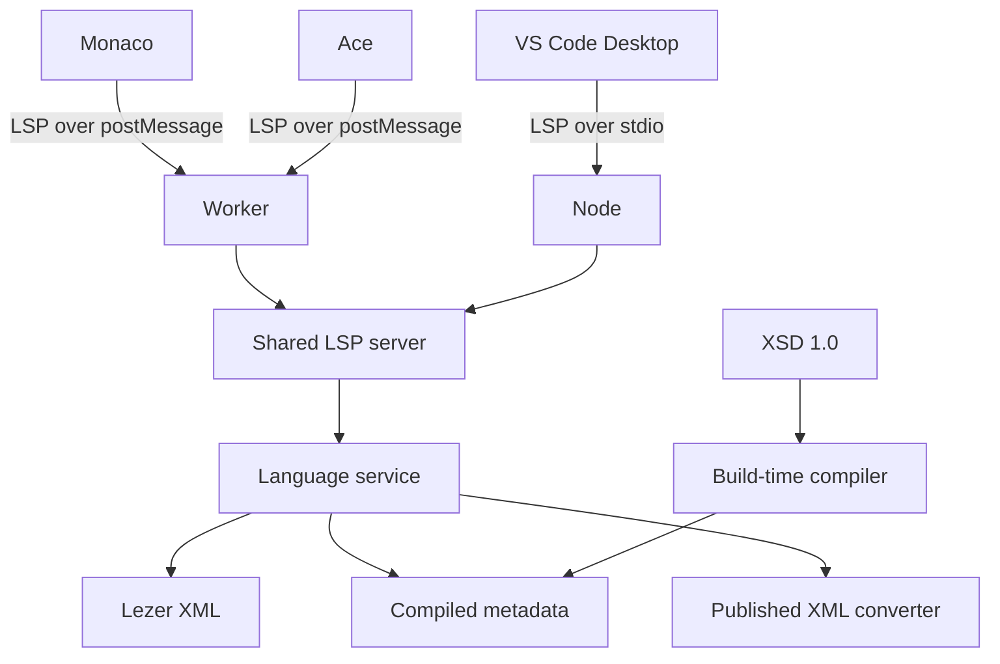

# 架构和兼容性

## ADR

1. **使用独立 pnpm 工作区和发布版转换器。** 本仓库是 `EIHRTeam/xml-lsp`，原转换器由 `EIHRTeam/xml` 单独维护。依赖精确锁定为 `@eihrteam/xml@1.0.0`。保留本仓库的 Apache-2.0，随包附带第三方许可证。
2. **同一分析服务连接两个标准 transport。** Lezer 提供容错语法树和增量片段，LSP SDK 单独负责 stdio、Worker 消息和 JSON-RPC。按 URI 缓存语法投影和诊断结果，增量同步接收每次文本变更。转换校验在语法和静态结构均通过后执行。
3. **构建期编译现有 XSD。** 参考文件声明 XSD 1.0、无目标命名空间，并注明以转换器 1.0.0 为依据。编译产物记录源路径、版本和 SHA-256。内容模型编译为状态机，用于序列、分支、无序分组和出现次数。运行时使用同一上下文进行静态诊断和补全。
4. **使用轻量浏览器客户端。** Monaco 和 Ace 通过共享的 `vscode-jsonrpc/browser` 会话调用标准 LSP。Monaco 直接注册原生 provider，Ace 直接使用 session、completer 和 tooltip。此方案避免在示例中加载 Monaco 的 VS Code Workbench 兼容层和 Ace 的额外语言服务器。VS Code 使用 `vscode-languageclient`。
5. **只改可证明安全的布局。** 格式化在 Schema 标识的 element-only 容器中修改标签和注释之间的 XML 空白。保留 mixed content、CDATA、实体、声明、属性值和 `xml:space="preserve"` 的子树。快速修复按当前文档版本生成，用户可以显式采用关闭标签的机械修复。

## Schema 范围

编译器支持参考 XSD 使用的命名类型和局部匿名类型、元素、属性、组引用、类型扩展、`sequence`、`choice`、`all`、枚举、`minLength` 和跳过额外属性检查的通配规则。元数据支持文档注释、默认值及固定值。当前 XSD 的说明主要集中于文档根，Hover 同时展示上下文类型和允许的属性、值及子元素。

编译器会报告未实现的构造及所在行，包含外部 schema、任意元素通配、复杂限制、模式断言和多命名空间模型。语言服务执行已声明范围内的静态检查。外部 XSD 验证器可用于额外的标准合规检查。

## XSD 与转换器

| 约束                 | XSD 1.0                                                               | 转换器 1.0.0 与语言服务                                                                              |
| -------------------- | --------------------------------------------------------------------- | ---------------------------------------------------------------------------------------------------- |
| 根元素的元数据与描述 | 可重复的 choice 允许缺少或重复单例字段                                | 转换器要求 `itemId`、`metainfo`、`description`。缺失由转换器诊断，重复字段沿用转换器读取第一个的行为 |
| 章节模式             | `table`、`audio` 和 `dialog` 是字符串属性，直接章节表格允许两种行类型 | 转换器根据 `true` 判定模式，并验证相应的实际结构                                                     |
| 对话与表格           | 描述标签结构、出现次数、部分属性值                                    | 转换器进一步验证发言顺序、表格几何、列宽和表头位置                                                   |
| 忽略未知内容         | 大部分普通标签开放额外属性，特定标签限制属性和子元素                  | 转换器容忍部分结构多余内容，例如根元素里的未知子元素。严格的上下文约束由 Schema 层单独报告           |
| 注释与历史列表       | 注释内限制嵌套，历史列表可在 `li` 后接兄弟子列表                      | 复用转换器规则，以两种历史子列表布局做一致性测试                                                     |

转换器 1.0.0 的解析错误只有异常类型和消息。语言服务使用稳定的 `conversion-error` 代码，范围落在根元素名称。Schema 和语法诊断可定位具体标签、属性、值和闭合位置。若同时存在多条转换规则冲突，修复前一条后再运行转换器即可得到后续错误。

## 工作边界

文档、引用、链接和 Schema 全部在本地处理。DTD 被禁用。分析预算默认为 5 Mi 个 UTF-16 码元、128 层嵌套和 50 万个语法节点。转换器表格的坐标和单格跨度上限为 1 万，单文档总展开预算为 25 万格。预算耗尽会产生可定位的诊断。诊断以 100 条为上限。

浏览器语言服务、Worker 和适配器使用纯 JavaScript 产物。两种 transport 默认使用消息式取消。大型文档的分析是同步计算，已进入解析的任务会运行到当前阶段返回。
